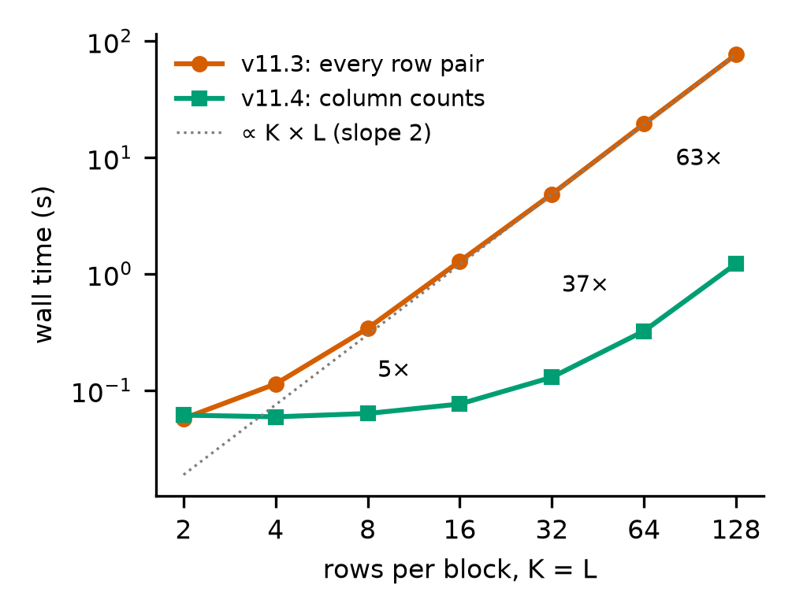

# Column counts in MULTIZ: `yama` no longer costs K × L per cell

**[Read the technical note (PDF, 9 pages)](paper/multiz_column_counts.pdf)** · Richard Burhans · 5 November 2026 · CC0

MULTIZ's `yama` aligns two alignment blocks by dynamic programming, and release 11.3 scored every cell by summing
over all K × L pairs of rows. Release 11.4 scores each cell from summaries made once per column: one score per
symbol for one block, symbol counts for the other, and counts of four gap classes. The output is unchanged. The merge as a whole still grows with the square of the depth, because scoring the merged blocks still visits every row pair.



| rows per block (K = L) | v11.3 | v11.4 | speed-up | output |
|---:|---:|---:|---:|---|
| 8 | 0.34 s | 0.063 s | 5.4× | identical |
| 32 | 4.84 s | 0.129 s | 37× | identical |
| 128 | 76.7 s | 1.22 s | 63× | identical |

At K = L = 128, `yama` itself ran about a thousand times faster (76.7 s to 0.06 s under `gprof`). The whole merge
gained 63× because scoring the merged blocks (`mafScoreRange`), which still visits every row pair, now takes 94% of
that synthetic run. On real data it is the larger of two remaining costs, measured as shares of sampled CPU time in
`multiz`: 63% of the deep merge and 53% of a whole 217-genome piece, against 35% and 45% for `yama`. That makes it the next target for deep merges. A grid of unequal
depths shows the 11.3 time follows K × L, not K² ([`paper/figure3.png`](paper/figure3.png)). On that grid, pairs with
the same K × L took times within about 20 percent of each other. Thinner shapes were not measured for this note.

The idea is not new. Scoring a column from symbol counts is a profile (Gribskov et al. 1987), Gotoh (1994) counted gap
states per column between groups of sequences, and Kececioglu and Zhang (1998) rewrote the interior recurrences for aligning two alignments under the same
pessimistic gap counts in terms of four per-column counts, in essentially O(mn) time. Scoring columns from symbol counts came from profile aligners and gap sums equal to 11.3's from reading how `yama` charges gaps. A profile of one deep merge showed where it would pay, and the literature was checked afterwards ([`measurements/prior_art_search.md`](measurements/prior_art_search.md)).

## Reproduce

```bash
bash probe/build_multiz.sh /tmp/multiz-cc                        # v11.3 and v11.4 from their tags, both -O2
python3 probe/run_sweep.py /tmp/multiz-cc measurements/sweep.csv  # about 5 minutes
python3 probe/run_sweep.py /tmp/multiz-cc measurements/grid.csv \
    --sizes 4x4,4x16,4x64,16x4,16x16,16x64,64x4,64x16,64x64
bash probe/profile_k128.sh /tmp/multiz-cc > measurements/gprof_k128.txt   # needs the k128l128 pair from the sweep
python3 probe/swap_order.py /tmp/multiz-cc measurements/swap_order.csv      # default pairs 4x16 and 4x64, needs the grid
python3 probe/swap_order.py /tmp/multiz-cc measurements/swap_order_rep1.csv --pairs 4x16,4x64,16x64   # rep2, rep3 the same
bash probe/profile_wholepiece.sh /tmp/multiz-cc INPUT_DIR measurements/wholepiece_tree.txt cs10_NCBI_RefSeq_softmasked \
    > /tmp/gprof_wholepiece_rerun.txt   # INPUT_DIR holds the files in measurements/wholepiece_inputs.sha256, about 1 h
```

## Experimental: counting in `mafScoreRange` (not part of any release)

`probe/mafScoreRange_counts.patch` applies the same per-column counting to `mafScoreRange` in v11.4's `mz_scores.c`,
regrouped within one block: each symbol and dash class is also paired with itself, and each row's pair with itself is
left out. Built with `-DMSR_CHECK`, every call computes both the original pair-by-pair score and the counted one and
stops on any difference. In review (round 16), that check never fired on 13 synthetic pairs, three hg38 5-way chunks
and a whole 217-genome piece, whose output was identical apart from `#` lines. `probe/msr_check.py` recomputes both
scores in Python from a MAF's blocks. Neither is part of MULTIZ until a release says so.
